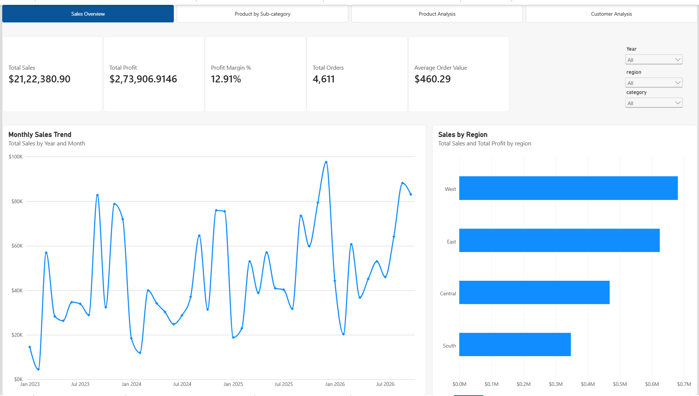

# Superstore Sales Analysis | SQL & Power BI

## Project Overview

This project analyzes Superstore sales data to understand sales performance, profitability, product trends, regional performance, and customer behavior.

SQL is used to query and analyze the data, while Power BI is used to build an interactive four-page dashboard that helps users explore business performance through KPIs, charts, and slicers.

The goal is to transform raw sales data into actionable business insights that support data-driven decision-making.

## Business Objectives

- Analyze overall sales, profit, and profit margin.
- Identify the best-performing products by sales.
- Identify products generating the largest losses.
- Compare sales and profitability across product sub-categories.
- Identify high-value customers and customers associated with losses.
- Compare sales performance across regions and over time.
- Enable interactive analysis using Year, Region, and Category slicers.

## Tools and Technologies

- **SQL** — Data aggregation, grouping, sorting, and business analysis.
- **Microsoft Power BI Desktop** — Dashboard development and visualization.
- **DAX** — Measures and calculations for dashboard KPIs.
- **Power Query** — Data preparation and transformation, where applicable.
- **GitHub** — Project documentation and version control.

## Dashboard Overview

The Power BI report contains four pages.

### 1. Sales Overview

Provides a high-level view of business performance.

**Key visuals:**
- Total Sales
- Total Profit
- Profit Margin %
- Total Orders
- Average Order Value
- Monthly Sales Trend
- Sales by Region

**Purpose:** Understand overall performance, monthly sales fluctuations, and differences between regions.

### 2. Product by Sub-category

Analyzes profit performance across product sub-categories.

**Key visual:**
- Profit by Sub-Category, with sales included in the analysis where configured.

**Purpose:** Identify profitable and loss-making sub-categories and investigate opportunities to improve product profitability.

### 3. Product Analysis

Focuses on individual product performance.

**Key visuals:**
- Top 10 Products by Sales
- Bottom 10 Products by Profit
- Total Product Sales
- Total Product Profit
- Distinct Products

**Purpose:** Identify high-revenue products and investigate products generating negative profit.

### 4. Customer Analysis

Examines customer-level sales and profitability.

**Key visuals:**
- Top 10 Customers by Sales
- Bottom 10 Customers by Profit
- Total Sales
- Total Customers
- Total Profit

**Purpose:** Understand customer contribution and identify customers whose profitability requires further investigation.

## Interactive Features

The report includes:

- Page navigation across all four dashboard pages.
- Year, Region, and Category slicers where relevant.
- Synchronized slicers for consistent filtering.
- Dynamic Top N and Bottom N product and customer analysis.
- KPI cards and interactive charts.

The slicers allow users to explore performance under different filter selections.

## SQL Analysis

The SQL scripts analyze business performance at different levels, including products and customers.

Example analysis topics include:

- Top 10 products by sales.
- Bottom 10 products by profit.
- Sales and profit by product.
- Top 10 customers by sales.
- Bottom 10 customers by profit.
- Customer order counts and profit margins.

Example: Top 10 Products by Sales

```sql
SELECT
    product_id,
    product_name,
    category,
    sub_category,
    ROUND(SUM(sales), 2) AS total_sales,
    ROUND(SUM(profit), 2) AS total_profit
FROM superstore
GROUP BY
    product_id,
    product_name,
    category,
    sub_category
ORDER BY total_sales DESC
LIMIT 10;
```

This query aggregates sales and profit at the product level and returns the ten products with the highest total sales.

*Note: The query uses `LIMIT`, which is supported by databases such as PostgreSQL, MySQL, and SQLite. Adapt the syntax if your database uses a different SQL dialect.*

## Key Business Insights

Based on the current dashboard results:

1. **Overall performance:** The dashboard reports approximately $2.12 million in sales, $273.9K in profit, and a 12.91% profit margin.
2. **Regional performance:** The West has the highest sales among the regions in the displayed overview.
3. **Product profitability:** Some products generate substantial negative profit despite appearing among the products analyzed for sales.
4. **Customer profitability:** Certain customers have high sales but negative profit, showing that revenue alone is not enough to evaluate customer value.
5. **Sub-category performance:** Tables and Bookcases show negative profit in the displayed sub-category analysis, while Copiers and Phones show strong positive profit.

These findings should be validated against the final report and its filter selections before being used for business decisions.

## Business Recommendations

- Investigate loss-making products by reviewing pricing, discounts, costs, and returns.
- Evaluate customer profitability alongside customer sales.
- Analyze regional sales and profit margins to identify opportunities for improvement.
- Investigate loss-making sub-categories before making inventory or promotional decisions.
- Monitor monthly sales and profitability to understand changes in business performance.

These recommendations identify areas for investigation; the dashboard alone does not establish the causes of negative profit.

## Project Structure

Organize the GitHub repository using a structure similar to the following:

```text
superstore-sales-analysis/
│
├── README.md
│
├── sql/
│   ├── 01_sales_analysis.sql
│   ├── 02_customer_analysis.sql
│   ├── 06_product_analysis.sql
│   └── ...other SQL scripts
│
├── powerbi/
│   └── Superstore_Sales_Dashboard.pbix
│
├── screenshots/
│   ├── 01_sales_overview.png
│   ├── 02_product_subcategory.png
│   ├── 03_product_analysis.png
│   └── 04_customer_analysis.png
│
└── data/
    └── README.md
```

Replace example filenames with the actual filenames in your project. Add other folders only if they contain relevant project files.

For large datasets, avoid committing the raw data unless you have permission to share it. You can instead document where the dataset came from and how to obtain it.

## How to Explore the Project

1. Clone or download this repository.
2. Review the SQL scripts in the `sql` folder.
3. Open the `.pbix` file in Microsoft Power BI Desktop.
4. If prompted, configure the data source or refresh the dataset.
5. Navigate through the four report pages.
6. Use the Year, Region, and Category slicers to explore the data.
7. Compare product and customer sales with their corresponding profitability.

The report requires access to the underlying dataset and any necessary data connections to refresh successfully.

## Skills Demonstrated

- SQL querying and aggregation
- Business data analysis
- Sales and profitability analysis
- Customer and product performance analysis
- KPI design
- DAX and data modeling, where implemented
- Power BI visualization and dashboard design
- Interactive filtering and report navigation
- Business insight development
- Technical documentation

## Conclusion

This project demonstrates how SQL and Power BI can be combined to analyze retail performance, identify potential profitability issues, and communicate business findings through an interactive dashboard.

The report provides a foundation for further analysis of discount effectiveness, profit margins, customer segments, and sales trends.

---

**Project:** Superstore Sales Analysis  
**Tools:** SQL, Microsoft Power BI Desktop  
**Author:** Ram Nivash
